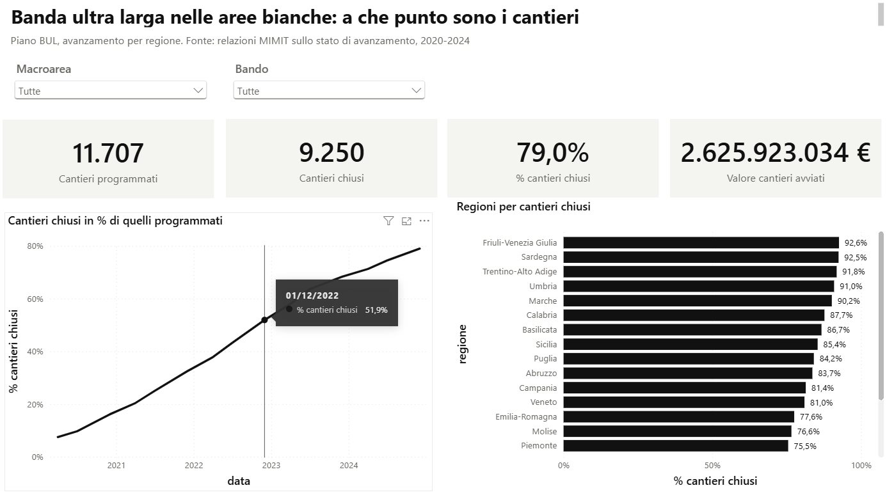

# Piano Banda Ultra Larga - dashboard Power BI

Dati sull'avanzamento del Piano BUL nelle aree bianche, per regione, dal 2020 al 2024.
Fonte: relazioni periodiche del MIMIT sullo stato di avanzamento, raccolte in un dataset
durante l'assegno di ricerca all'Università Politecnica delle Marche.
`prepara_dati.R` rigenera i CSV in `dati/` a partire da `dataset-bul-v2.dta`.



Altre pagine: [le tre fasi](immagini/pbi-fasi.png), [dettaglio regione](immagini/pbi-regioni.png),
[modello dati](immagini/pbi-modello.png).

## Aprire il progetto

Doppio clic su `BandaUltraLarga.pbip` (Power BI Desktop, formato progetto: modello in TMDL,
report in PBIR). Al primo avvio fare **Aggiorna** per caricare i CSV. Se la cartella viene
spostata, aggiornare il parametro `CartellaDati` (Trasforma dati > Gestisci parametri),
che deve finire con `\`.

Pagine: Panoramica, Le tre fasi, Dettaglio regione.

## Tabelle (schema a stella)

| tabella | righe | contenuto |
|---|---|---|
| `fatti_avanzamento` | 900 | regione × data × fase: `approvati_o_chiusi`, `consegnati_o_aperti` (valori cumulati) |
| `fatti_economico` | 440 | regione × data: valore dei cantieri avviati, avanzamento lavori, lavori contabilizzati dal direttore lavori (euro, cumulati) |
| `dim_regione` | 20 | nome, codice ISTAT, NUTS2, macroarea, bando (1-3), cantieri programmati (apr 2020, apr 2023, dic 2023) |
| `dim_fase` | 3 | progetto definitivo, progetto esecutivo, lavori, con il significato delle due colonne in ogni fase |
| `dim_data` | 23 | data, anno, mese, etichetta (`apr 2020`), ordine, flag rilevazione fasi e fine anno |

Relazioni (tutte molti-a-uno, filtro singolo):
- `fatti_avanzamento[codice_istat]` → `dim_regione[codice_istat]`
- `fatti_avanzamento[fase_id]` → `dim_fase[fase_id]`
- `fatti_avanzamento[data]` → `dim_data[data]`
- `fatti_economico[codice_istat]` → `dim_regione[codice_istat]`
- `fatti_economico[data]` → `dim_data[data]`

In Power Query: `codice_istat` come testo (ha lo zero davanti), `data` come data.
`dim_data[periodo]` va ordinata per `dim_data[ordine]`.

## Attenzione: i valori sono cumulati

Ogni riga è lo stock a quella data, non il flusso del periodo. Sommare nel tempo è sbagliato:
le misure devono prendere l'ultima data disponibile nel contesto. Le date delle due tabelle dei
fatti non coincidono (le fasi hanno 15 rilevazioni, i valori economici 22), quindi l'ultima data
va cercata nella tabella dei fatti, non in `dim_data`.

## Misure DAX

```dax
Cantieri programmati = SUM ( dim_regione[programmati_dic2023] )

Completati =
VAR ultima = CALCULATE ( MAX ( fatti_avanzamento[data] ) )
RETURN CALCULATE ( SUM ( fatti_avanzamento[approvati_o_chiusi] ), dim_data[data] = ultima )

Consegnati o aperti =
VAR ultima = CALCULATE ( MAX ( fatti_avanzamento[data] ) )
RETURN CALCULATE ( SUM ( fatti_avanzamento[consegnati_o_aperti] ), dim_data[data] = ultima )

% completamento = DIVIDE ( [Completati], [Cantieri programmati] )

Mancanti = [Cantieri programmati] - [Completati]

Completati un anno prima =
VAR ultima = CALCULATE ( MAX ( fatti_avanzamento[data] ) )
RETURN CALCULATE ( SUM ( fatti_avanzamento[approvati_o_chiusi] ), dim_data[data] = EDATE ( ultima, -12 ) )

Variazione in un anno = [Completati] - [Completati un anno prima]

Valore cantieri avviati =
VAR ultima = CALCULATE ( MAX ( fatti_economico[data] ) )
RETURN CALCULATE ( SUM ( fatti_economico[valore_cantieri_avviati] ), dim_data[data] = ultima )

Lavori contabilizzati =
VAR ultima = CALCULATE ( MAX ( fatti_economico[data] ) )
RETURN CALCULATE ( SUM ( fatti_economico[lavori_contabilizzati] ), dim_data[data] = ultima )

% contabilizzato = DIVIDE ( [Lavori contabilizzati], [Valore cantieri avviati] )

Posizione regione =
RANKX ( ALL ( dim_regione[regione] ), [% completamento], , DESC )
```

`% completamento` va letto con un filtro sulla fase (di solito Lavori): senza filtro somma le tre
fasi e supera il 100%.

## Note sui dati

- Nelle due fasi di progettazione un progetto prima viene approvato e poi consegnato per la
  costruzione, quindi i consegnati sono di solito meno degli approvati. Nei lavori invece un
  cantiere prima viene aperto e poi chiuso. Le percentuali di completamento usano sempre
  `approvati_o_chiusi` (progetto approvato, cantiere chiuso).
- Le colonne non si chiamano come le misure (`Completati`) perché Power BI non accetta una misura
  con lo stesso nome di una colonna della stessa tabella, nemmeno con maiuscole diverse.
- Alcuni valori cumulati scendono nel tempo (ad esempio i progetti definitivi approvati in Abruzzo
  e Lazio): probabilmente sono revisioni del piano, da verificare nelle relazioni.
- I cantieri programmati cambiano nel tempo: il denominatore usato è dicembre 2023, come nel caso studio.
- I valori economici non hanno la rilevazione di luglio 2023, che c'è invece per le fasi.
